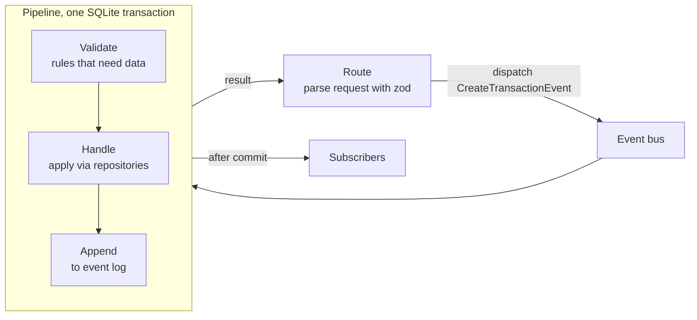

# 0012. Writes go through a business event pipeline

- Status: accepted
- Date: 2026-11-03

## Context

Every write (create, update or delete of a transaction or project) needs the same steps: business checks that need data, the change itself, keeping a history, and telling interested parts of the app. Putting these steps into each service method duplicates them and makes the order easy to get wrong. The project also wants a clear, testable flow from request to stored data.

## Decision

Every write is a **business event** named after the business action: `CreateTransactionEvent`, `UpdateTransactionEvent`, `DeleteTransactionEvent`, `CreateProjectEvent`, `UpdateProjectEvent`, `DeleteProjectEvent`. The event types and the shape of a recorded event live in `packages/schema` (`domain/event.ts`); the pipeline lives in `apps/api/src/events`.

1. A route parses and validates the request with the schema, then dispatches the event with its data to the **event bus**.
2. The bus looks up the event's **handler** and runs it through the **pipeline**: _validate_ (rules that need the database, e.g. the tagged project exists, a project with transactions cannot be deleted), _handle_ (change state through the repositories) and _append_ (store the recorded event with before/after snapshots in the `events` table with an increasing `sequence`). These steps share one SQLite transaction, so state and log never disagree.
3. After the commit the bus notifies **subscribers** (e.g. logging). A failing subscriber never undoes the write.
4. The handler's result goes back to the route, which builds the response with the schema.

Reads (lists, totals, statistics) do not go through the bus: they are services over the repositories. The state tables are the source of truth; the event log is an append-only history exposed at `GET /api/events` (activity feed). This is **not** full event sourcing: state is not rebuilt from the log.

## Options considered

- Plain service methods: simplest, but the history and cross-cutting steps would be repeated per method.
- Full event sourcing (state rebuilt from events): powerful, but projections, replays and snapshotting are far beyond the scope of a school project.
- Node `EventEmitter` alone: fire-and-forget, no result, no shared transaction, no ordering guarantee.
- Generic CRUD event names (`TransactionChanged`): lose the business meaning the log should carry.

## Consequences

- Each step is a small unit that is tested in isolation (handlers with mocked repositories, the bus with fake handlers), and the whole flow is covered by integration tests.
- Every write automatically lands in the activity feed.
- Adding a write means adding an event type to the schema, a handler and a route; forgetting the handler fails at startup, not at runtime.
