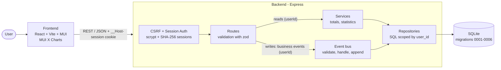

# Architecture

## Layers

| Layer        | Responsibility                                                                         | Tested with                      |
| ------------ | -------------------------------------------------------------------------------------- | -------------------------------- |
| Schema       | Domain objects, API contract, auth contract, rules without a database                  | Contract tests (Vitest)          |
| Auth         | `scrypt` hashing, SHA-256 session tokens, sliding-window rate limiter (**TDD target**) | Unit + Integration (Vitest)      |
| Routes       | HTTP, CSRF + session middleware, input validation, status codes, dispatching events    | Integration (supertest + IDOR)   |
| Event bus    | Pipeline per business event: validate, handle, append to log ([0012][adr12])           | Unit (fake handlers)             |
| Handlers     | One per business event, business rules that need data (scoped to `userId`)             | Unit (repositories mocked)       |
| Services     | Read side: balances, budget remainder, statistics (**TDD target**, scoped to `userId`) | Unit (repositories mocked)       |
| Repositories | SQL access scoped by `user_id`, mapped to domain types                                 | Integration (in-memory SQLite)   |
| Database     | Versioned, forward-only migrations ([0011][adr11])                                     | Integration (migration runner)   |
| Frontend     | MUI pages, MUI X Charts dashboard, auth & theme switching ([0013][adr13])              | Component (Testing Library, MSW) |

[adr11]: adr/0011-database-migrations.md
[adr12]: adr/0012-business-event-pipeline.md
[adr13]: adr/0013-frontend-charts-and-structure.md
[adr14]: adr/0014-authentication-and-multi-user.md

## Domain

Defined with its validation rules in `packages/schema` ([ADR 0009](adr/0009-domain-model-and-validation-in-schema.md), [ADR 0010](adr/0010-accounts-and-project-tags.md), [ADR 0014][adr14]).

- **User & Session**: each account has an email (normalised lowercase ASCII) and display name; passwords are hashed with `scrypt` and never leave the repository. Sessions are stored as SHA-256 token digests with a 30-minute idle timeout and 7-day absolute timeout.
- **Account**: every transaction is booked on exactly one account, `main` (the normal account) or `savings`. The account is required and cannot change. Overall totals are the sum of both accounts for the signed-in user.
- **Project**: name (unique per user), description and an optional initial budget (fixed at creation, a guide rather than a hard ceiling). A project is a **tag**: transactions from either account can be tagged with it. Tagged expenses use up the budget, tagged income refills it: `remaining = budget - expense + income`, which may go negative.
- **Transaction**: account, income/expense, amount in cents, date, description, optional project tag (must belong to the same user).
- **Business event**: every write is recorded as one of `Create|Update|Delete` + `Transaction|Project` + `Event`, with `userId` and before/after snapshots, in an append-only event log.

## API

All responses are built with, and validated against, the schema package.

| Method and path                | Schema (request / response)                         | Notes                                     |
| ------------------------------ | --------------------------------------------------- | ----------------------------------------- |
| `GET /api/health`              | `HealthSchema`                                      | public health check                       |
| `POST /api/auth/register`      | `RegisterRequest` / `SessionResponse`               | creates user + sets `__Host-session`, 201 |
| `POST /api/auth/login`         | `LoginRequest` / `SessionResponse`                  | verifies password + rotates session, 200  |
| `POST /api/auth/logout`        | —                                                   | revokes session + clears cookie, 204      |
| `GET /api/auth/me`             | `SessionResponse`                                   | current signed-in user & session expiry   |
| `GET /api/accounts`            | `AccountsResponse`                                  | per account and total                     |
| `GET /api/projects`            | `ProjectListResponse`                               | with derived totals                       |
| `POST /api/projects`           | `CreateProjectRequest` / `ProjectResponse`          | `CreateProjectEvent`, 201                 |
| `GET /api/projects/:id`        | `ProjectParams` / `ProjectResponse`                 |                                           |
| `PATCH /api/projects/:id`      | `UpdateProjectRequest` / `ProjectResponse`          | `UpdateProjectEvent`                      |
| `DELETE /api/projects/:id`     | `ProjectParams`                                     | `DeleteProjectEvent`, 204, 409 if tagged  |
| `GET /api/transactions`        | `ListTransactionsQuery` / `TransactionListResponse` | newest first, filters                     |
| `POST /api/transactions`       | `CreateTransactionRequest` / `TransactionResponse`  | `CreateTransactionEvent`, 201             |
| `GET /api/transactions/:id`    | `TransactionParams` / `TransactionResponse`         |                                           |
| `PATCH /api/transactions/:id`  | `UpdateTransactionRequest` / `TransactionResponse`  | `UpdateTransactionEvent`                  |
| `DELETE /api/transactions/:id` | `TransactionParams`                                 | `DeleteTransactionEvent`, 204             |
| `GET /api/stats`               | `StatsQuery` / `StatsResponse`                      | data for the dashboard charts             |
| `GET /api/events`              | `ListEventsQuery` / `EventListResponse`             | activity feed, newest first               |

Errors use `ApiErrorSchema`: 400 `validation_error`, 401 `unauthorized`, 403 `forbidden`, 404 `not_found`, 409 `conflict`, 422 `unprocessable`, 429 `too_many_requests`, 500 `internal_error`.
