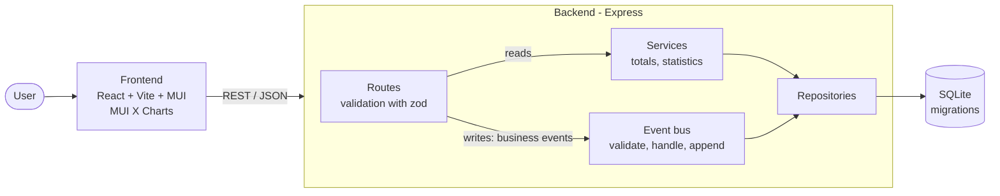

# Architecture

## Layers

| Layer        | Responsibility                                                               | Tested with                      |
| ------------ | ---------------------------------------------------------------------------- | -------------------------------- |
| Schema       | Domain objects, API contract, rules without a database                       | Contract tests (Vitest)          |
| Routes       | HTTP, input validation, status codes, dispatching events                     | Integration (supertest)          |
| Event bus    | Pipeline per business event: validate, handle, append to log ([0012][adr12]) | Unit (fake handlers)             |
| Handlers     | One per business event, business rules that need data                        | Unit (repositories mocked)       |
| Services     | Read side: balances, budget remainder, statistics (**TDD target**)           | Unit (repositories mocked)       |
| Repositories | SQL access, mapped to domain types                                           | Integration (in-memory SQLite)   |
| Database     | Versioned, forward-only migrations ([0011][adr11])                           | Integration (migration runner)   |
| Frontend     | MUI pages, MUI X Charts dashboard, API client ([0013][adr13])                | Component (Testing Library, MSW) |

[adr11]: adr/0011-database-migrations.md
[adr12]: adr/0012-business-event-pipeline.md
[adr13]: adr/0013-frontend-charts-and-structure.md

## Domain

Defined with its validation rules in `packages/schema` ([ADR 0009](adr/0009-domain-model-and-validation-in-schema.md), [ADR 0010](adr/0010-accounts-and-project-tags.md)).

- **Account**: every transaction is booked on exactly one account, `main` (the normal account) or `savings`. The account is required and cannot change. Overall totals are the sum of both accounts.
- **Project**: name, description and an optional initial budget (fixed at creation, a guide rather than a hard ceiling). A project is a **tag**: transactions from either account can be tagged with it. Tagged expenses use up the budget, tagged income refills it: `remaining = budget - expense + income`, which may go negative.
- **Transaction**: account, income/expense, amount in cents, date, description, optional project tag.
- **Business event**: every write is recorded as one of `Create|Update|Delete` + `Transaction|Project` + `Event`, with before/after snapshots, in an append-only event log.

## API

All responses are built with, and validated against, the schema package.

| Method and path                | Schema (request / response)                         | Notes                                    |
| ------------------------------ | --------------------------------------------------- | ---------------------------------------- |
| `GET /api/health`              | `HealthSchema`                                      |                                          |
| `GET /api/accounts`            | `AccountsResponse`                                  | per account and total                    |
| `GET /api/projects`            | `ProjectListResponse`                               | with derived totals                      |
| `POST /api/projects`           | `CreateProjectRequest` / `ProjectResponse`          | `CreateProjectEvent`, 201                |
| `GET /api/projects/:id`        | `ProjectParams` / `ProjectResponse`                 |                                          |
| `PATCH /api/projects/:id`      | `UpdateProjectRequest` / `ProjectResponse`          | `UpdateProjectEvent`                     |
| `DELETE /api/projects/:id`     | `ProjectParams`                                     | `DeleteProjectEvent`, 204, 409 if tagged |
| `GET /api/transactions`        | `ListTransactionsQuery` / `TransactionListResponse` | newest first, filters                    |
| `POST /api/transactions`       | `CreateTransactionRequest` / `TransactionResponse`  | `CreateTransactionEvent`, 201            |
| `GET /api/transactions/:id`    | `TransactionParams` / `TransactionResponse`         |                                          |
| `PATCH /api/transactions/:id`  | `UpdateTransactionRequest` / `TransactionResponse`  | `UpdateTransactionEvent`                 |
| `DELETE /api/transactions/:id` | `TransactionParams`                                 | `DeleteTransactionEvent`, 204            |
| `GET /api/stats`               | `StatsQuery` / `StatsResponse`                      | data for the dashboard charts            |
| `GET /api/events`              | `ListEventsQuery` / `EventListResponse`             | activity feed, newest first              |

Errors use `ApiErrorSchema`: 400 `validation_error`, 404 `not_found`, 409 `conflict`, 422 `unprocessable`.
