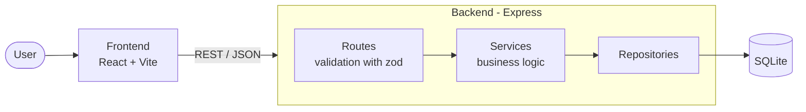

# Architecture (rough)

## Layers

| Layer        | Responsibility                                   | Tested with                     |
| ------------ | ------------------------------------------------ | ------------------------------- |
| Routes       | HTTP, input validation, status codes             | Integration (supertest)         |
| Services     | Business rules, budget/balance calculation       | Unit (repositories mocked)      |
| Repositories | SQL access, mapped to domain types               | Integration (in-memory SQLite)  |
| Frontend     | Components, pages, API client                    | Component (Testing Library, MSW) |

## Domain (draft)

- **Project**: name, optional budget
- **Transaction**: amount, income/expense, date, description, optional project (none = main finances)
