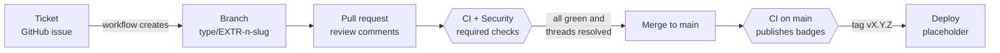
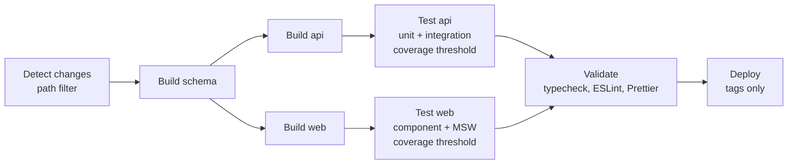

# CI/CD pipeline and TDD

Two parts of the project rubric, shown with evidence you can reproduce. Decisions behind the pipeline are in [ADR 0004](adr/0004-path-filtered-ci-pipeline.md) and [ADR 0005](adr/0005-security-tooling.md); the test approach is in the [test concept](testkonzept.md).

## 1. CI/CD pipeline

### From change to `main`



`main` only accepts pull requests. A merge needs every required check green and every review thread resolved (repository ruleset); a failing check blocks the merge button.

### CI workflow (`.github/workflows/ci.yml`)



| Stage           | What it does                                                                               | Fails the run when                                  |
| --------------- | ------------------------------------------------------------------------------------------ | --------------------------------------------------- |
| Detect changes  | Path filter decides what to build and test (docs-only changes skip everything)             | never; it only routes                               |
| Build schema    | Compiles `packages/schema` once and shares `dist` as an artifact                           | the contract does not compile                       |
| Build api / web | Compiles each app against the schema `dist` (the web build also typechecks)                | a type error or a broken build                      |
| Test api / web  | Runs the Vitest suites with v8 coverage; uploads the coverage report as an artifact        | a test fails, or coverage drops below the threshold |
| Validate        | Typecheck of every workspace, ESLint, Prettier (`FORMAT_BLOCKING: 'true'`); updates badges | a type, lint or formatting error anywhere           |
| Deploy          | Placeholder, only for tags `vX.Y.Z` or `vX.Y.Z-ALPHA` on `main`                            | not run for pull requests                           |

Design points:

- **Build once, reuse.** The schema `dist` is built once and downloaded by the other jobs, so api and web test the same compiled contract.
- **Path filters.** An api-only change skips the web jobs; a schema or root-config change runs everything.
- **No duplicate runs.** Pushes run only on `main` and tags, pull requests run on `pull_request`, and a newer push to a PR cancels the older PR run (never a run on `main`).
- **Coverage thresholds are gates**, not reports: `apps/api/vitest.config.ts` (90 lines, 90 statements, 90 functions, 85 branches) and `apps/web/vitest.config.ts` (90 lines, 90 statements, 85 functions, 80 branches).
- Reference run on `main` (all green): detect 13 s, schema 17 s, api and web build 27 s in parallel, tests 34 s and 44 s in parallel, validate 36 s. About 2.5 minutes from push to green.

### Security workflow (`.github/workflows/security.yml`)

Runs on pull requests, on `main` and weekly, and is a required check as well:

| Job               | Catches                                                                  |
| ----------------- | ------------------------------------------------------------------------ |
| Secret scan       | Committed secrets (gitleaks); the pre-commit hook does the same locally  |
| Dependency review | Newly introduced vulnerable or disallowed dependencies                   |
| npm audit         | Known high or critical advisories in the lockfile (`--audit-level=high`) |
| CodeQL            | Static analysis of the TypeScript code                                   |

This pipeline has already paid off: it blocked a high-severity `body-parser` advisory (fixed in PR #12), and the weekly Dependabot job exposed a `minimatch` advisory that needed an override (PR #18).

### Branch and ticket automation

- Opening a GitHub issue from a form creates `type/EXTR-<issue>-<slug>` from `main` (`ticket-branch.yml`).
- `branch-name.yml` fails a PR whose branch does not match `^(feature|hotfix|setup|release)/EXTR-[0-9]+-[A-Za-z0-9-]+$`.

### Known gaps

- The CI test jobs contain an `E2E tests` step (`npm run test:e2e --if-present`), but no workspace defines `test:e2e`, so the step does nothing today. Integration tests (supertest against the Express app with in-memory SQLite) run inside `npm test`.
- The pipeline uploads HTML/JSON coverage reports; it does not produce JUnit XML yet, so test results are visible in the job log and the Checks tab, not as a downloadable report.
- Deploy is a placeholder: there is no hosting target.

## 2. TDD

The calculation services (the TDD target in the [test concept](testkonzept.md)) were developed test-first in three red, green, refactor cycles. Each red commit contains the tests plus a stub that throws, so it still typechecks and the new tests fail for the right reason. The numbers below were measured by checking out each commit and running `npx vitest run --root apps/api test/services/`.

| Cycle                                                                             | Step     | Commit    | Result                                                    |
| --------------------------------------------------------------------------------- | -------- | --------- | --------------------------------------------------------- |
| 1. Project budget remainder (`remaining = budget - expense + income`)             | red      | `a06ad7f` | 10 of 10 tests fail                                       |
|                                                                                   | green    | `dbd437d` | 10 of 10 pass                                             |
| 2. Balance per account and overall total                                          | red      | `247a8c8` | 7 fail, 10 pass (cycle 1 stays green)                     |
|                                                                                   | green    | `05c9ea2` | 17 of 17 pass                                             |
| 3. Monthly statistics and range (flows, month-end balances, spending per project) | red      | `e9829e9` | 11 fail, 17 pass                                          |
|                                                                                   | green    | `a581be4` | 28 of 28 pass                                             |
|                                                                                   | refactor | `51f4326` | 28 of 28 pass (single-pass grouping, behaviour unchanged) |

What the cycles show:

- **Red first.** Every cycle starts with failing tests that describe the rule (negative remainder when over budget, tagged income refilling a budget, gaps as zero in a month series, balances that include history before the range).
- **Green with the least code**, then a refactor with the safety net of the green suite (cycle 3).
- **The tests outlive the cycle.** The same suites run in CI on every pull request and guard the services against later changes.

### Reproduce it

```bash
git worktree add ../tdd-check a06ad7f && cd ../tdd-check
npm ci && npm run build:schema
npx vitest run --root apps/api test/services/   # red: 10 failed
git checkout dbd437d
npx vitest run --root apps/api test/services/   # green: 10 passed
```

The same works for the other pairs: `247a8c8` then `05c9ea2`, and `e9829e9` then `a581be4` then `51f4326`.

### The rest of the test pyramid

| Level       | Where                                                 | Tooling                                       |
| ----------- | ----------------------------------------------------- | --------------------------------------------- |
| Contract    | `packages/schema/test`                                | Vitest, parse valid and invalid payloads      |
| Unit        | `apps/api/test` (services, handlers, bus)             | Vitest, repositories mocked with `vi.fn`      |
| Integration | `apps/api/test` (repositories, migrations, endpoints) | Vitest + supertest, in-memory SQLite          |
| Component   | `apps/web/test`                                       | Vitest + Testing Library, API mocked with MSW |
